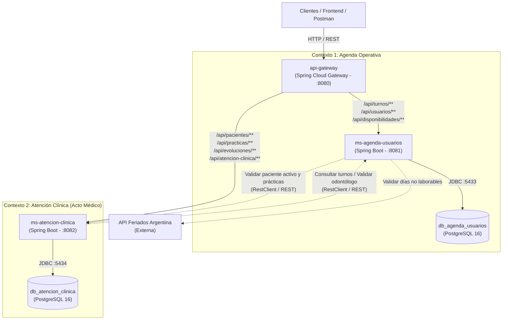

# Plataforma de Gestión de Turnos Odontológicos 🦷

Este repositorio contiene la arquitectura de microservicios para la plataforma de gestión de turnos y atención odontológica.
El sistema se encuentra diseñado bajo el enfoque de **Domain-Driven Design (DDD)** con separación en dos grandes contextos delimitados (*Bounded Contexts*): **"Agenda Operativa"** y **"Atención Clínica"**, implementando el patrón **Database-per-Service** con **Spring Boot 3.4.2**, **Java 21**, **Spring Cloud Gateway** y **PostgreSQL 16**.

---

## 📋 Tabla de Contenidos

1. [Arquitectura del Sistema y Bounded Contexts](#-arquitectura-del-sistema-y-bounded-contexts)
2. [División de Microservicios y Responsabilidades](#-división-de-microservicios-y-responsabilidades)
3. [Requisitos Previos](#-requisitos-previos)
4. [Mapa de Puertos y Servicios](#-mapa-de-puertos-y-servicios)
5. [Inicio Rápido (Guía de Ejecución Local)](#-inicio-rápido-guía-de-ejecución-local)
   - [Paso 1: Levantar las Bases de Datos (Docker)](#paso-1-levantar-las-bases-de-datos-docker)
   - [Paso 2: Compilar e Instalar `common-excepciones` (¡Obligatorio!)](#paso-2-compilar-e-instalar-common-excepciones-obligatorio)
   - [Paso 3: Ejecutar los Microservicios y Gateway](#paso-3-ejecutar-los-microservicios-y-gateway)
6. [Documentación y Swagger UI](#-documentación-y-swagger-ui)
7. [Credenciales y Datos de Conexión de Bases de Datos](#-credenciales-y-datos-de-conexión-de-bases-de-datos)
8. [Estructura del Proyecto y Esquemas SQL](#-estructura-del-proyecto-y-esquemas-sql)
9. [Cómo Conectarse a las Bases de Datos](#-cómo-conectarse-a-las-bases-de-datos)
   - [Desde Cliente Gráfico](#opción-1-cliente-gráfico-dbeaver-pgadmin-datagrip-o-extensión-de-ide)
   - [Desde la Terminal con Docker CLI (psql)](#opción-2-conexión-por-consola-vía-docker-exec)
10. [Configuración en los Microservicios (Spring Boot)](#-configuración-en-los-microservicios-spring-boot)
11. [Comandos Frecuentes de Gestión](#-comandos-frecuentes-de-gestión)
12. [Reinicio Limpio / Reset de Datos (Importante)](#-reinicio-limpio--reset-de-datos-importante)
13. [Resolución de Problemas Comunes (Troubleshooting)](#-resolución-de-problemas-comunes-troubleshooting)

---

## 🏛 Arquitectura del Sistema y Bounded Contexts

El sistema desacopla la **logística operativa** del **acto clínico médico**, eliminando acoplamientos innecesarios y garantizando la privacidad y consistencia del historial médico:



---

## 🧩 División de Microservicios y Responsabilidades

### 1. MS 1: `ms-agenda-usuarios` ("Agenda Operativa")
- **Propósito:** Administra exclusivamente la logística del consultorio, el personal y la asignación temporal de recursos.
- **Responsabilidades:**
  - **Personal del Consultorio (`usuarios`):** Registro de administradores, recepcionistas y odontólogos (incluyendo validación de matrícula profesional y autenticación mediante `keycloak_id`).
  - **Disponibilidad Horaria (`disponibilidad_odontologos`):** Configuración de jornadas laborales por día de la semana (`LUNES` a `DOMINGO`) y rangos horarios (`hora_inicio` y `hora_fin`).
  - **Reserva Horaria (`turnos`):** Planificación del tiempo de consulta, validación de no superposición de horarios, estado del turno (`PROGRAMADO`, `ATENDIDO`, `INASISTIDO`, `CANCELADO`), control de feriados nacionales y auditoría del usuario que originó la reserva.
- **Base de Datos asociada:** `db_agenda_usuarios` (Puerto host: `5433`).

### 2. MS 2: `ms-atencion-clinica` ("Atención Clínica")
- **Propósito:** Agrupa todo el **acto médico**, la historia clínica confidencial y el nomenclador odontológico.
- **Responsabilidades:**
  - **Ficha del Paciente (`pacientes`):** Datos demográficos, de contacto y estado activo/inactivo del paciente.
  - **Nomenclador Odontológico (`practicas_odontologicas`):** Catálogo de códigos nomencladores, nomenclaturas y descripción de procedimientos dentales.
  - **Evolución Clínica (`evoluciones_clinicas`):** Diagnósticos, notas clínicas, observaciones de evolución del tratamiento y profesional responsable.
  - **Prácticas Realizadas en Consulta (`turno_practicas_realizadas`):**
    > **Decisión de Diseño Clave:** Esta tabla se ubica dentro de este microservicio vinculándose físicamente con la **evolución clínica** (`evolucion_id`) y con la **práctica odontológica** (`practica_id`), manteniendo una referencia lógica al `turno_id` de la agenda. De esta manera, el registro de lo realizado en el sillón dental es transaccional, cohesivo y parte integral del acto médico.
- **Base de Datos asociada:** `db_atencion_clinica` (Puerto host: `5434`).

### 3. Componentes de Soporte:
- **`api-gateway` (Puerto `8080`):** Enrutador reactivo único que expone un API unificado para el exterior.
- **`common-excepciones` (Librería compartida):** Manejo centralizado de excepciones de negocio (`ResourceNotFoundException`, `ConflictException`, `ExternalServiceException`) y respuestas `@RestControllerAdvice`.

---

## ⚙ Requisitos Previos

- **Java Development Kit (JDK) 21** (Eclipse Temurin, Amazon Corretto u OpenJDK 21):
  ```bash
  java -version
  ```
- **Apache Maven 3.9+**:
  ```bash
  mvn -version
  ```
- **Docker Desktop** (o Docker Engine + Docker Compose).
- Cliente SQL gráfico opcional (DBeaver, pgAdmin, DataGrip, VS Code Database Client).

---

## 🗺 Mapa de Puertos y Servicios

| Componente | Tipo / Framework | Puerto Host | Descripción | Swagger UI / Acceso |
| :--- | :--- | :--- | :--- | :--- |
| **`api-gateway`** | Spring Cloud Gateway | `8080` | Enrutador unificado reactivo | `http://localhost:8080` |
| **`ms-agenda-usuarios`** | Spring Boot 3.4.2 | `8081` | Personal, disponibilidad y turnos | [Swagger UI](http://localhost:8081/swagger-ui.html) |
| **`ms-atencion-clinica`** | Spring Boot 3.4.2 | `8082` | Pacientes, evoluciones y prácticas | [Swagger UI](http://localhost:8082/swagger-ui.html) |
| **`common-excepciones`** | Librería JAR Java | N/A | DTO de error y excepciones globales | Dependencia compartida local (`.m2`) |
| **`db_agenda_usuarios`** | PostgreSQL 16 (Docker) | `5433` | Base de datos de Agenda y Personal | `localhost:5433` |
| **`db_atencion-clinica`** | PostgreSQL 16 (Docker) | `5434` | Base de datos de Atención Clínica | `localhost:5434` |

---

## 🚀 Inicio Rápido (Guía de Ejecución Local)

### Paso 1: Levantar las Bases de Datos (Docker)

Desde la raíz del proyecto:
```bash
docker compose up -d
```
O bien:
```bash
docker compose -f docker-compose.dev.yml up -d
```
Verifica que los contenedores `pg_agenda_usuarios` y `pg_atencion_clinica` figuren `Up`:
```bash
docker compose ps
```

### Paso 2: Compilar el Proyecto (POM Agregador Raíz)

Gracias al `pom.xml` agregador en la raíz del repositorio, puedes compilar e instalar todos los módulos en el orden correcto con un único comando:

```bash
mvn clean install -DskipTests
```

*(O si prefieres compilar únicamente la librería compartida: `cd common-excepciones && mvn clean install && cd ..`)*

### Paso 3: Ejecutar los Microservicios y Gateway

Abre terminales separadas para cada servicio:

#### Terminal 1 — Agenda Operativa y Usuarios (Puerto 8081)
```bash
cd ms-agenda-usuarios
mvn spring-boot:run
```

#### Terminal 2 — Atención Clínica (Puerto 8082)
```bash
cd ms-atencion-clinica
mvn spring-boot:run
```

#### Terminal 3 — API Gateway (Puerto 8080)
```bash
cd api-gateway
mvn spring-boot:run
```

---

## 📖 Documentación y Swagger UI

- **Swagger UI Agenda y Usuarios:** [http://localhost:8081/swagger-ui.html](http://localhost:8081/swagger-ui.html)  
  *(OpenAPI JSON: `http://localhost:8081/v3/api-docs`)*
- **Swagger UI Atención Clínica:** [http://localhost:8082/swagger-ui.html](http://localhost:8082/swagger-ui.html)  
  *(OpenAPI JSON: `http://localhost:8082/v3/api-docs`)*

---

## 🔑 Credenciales y Datos de Conexión de Bases de Datos

| Parámetro | Base de Datos: Agenda y Usuarios | Base de Datos: Atención Clínica |
| :--- | :--- | :--- |
| **Microservicio** | `ms-agenda-usuarios` | `ms-atencion-clinica` |
| **Nombre Contenedor** | `pg_agenda_usuarios` | `pg_atencion_clinica` |
| **Host** | `localhost` / `127.0.0.1` | `localhost` / `127.0.0.1` |
| **Puerto en Host (Tu PC)** | **`5433`** | **`5434`** |
| **Puerto Interno Docker** | `5432` | `5432` |
| **Database Name** | `db_agenda_usuarios` | `db_atencion_clinica` |
| **Usuario** | `postgres` | `postgres` |
| **Contraseña** | `password123` | `password123` |
| **Script DDL Inicial** | `./database/init-agenda-usuarios.sql` | `./database/init-atencion-clinica.sql` |
| **Carpeta de Persistencia**| `./data/agenda-usuarios` | `./data/atencion-clinica` |
| **JDBC URL** | `jdbc:postgresql://localhost:5433/db_agenda_usuarios` | `jdbc:postgresql://localhost:5434/db_atencion_clinica` |

---

## 📁 Estructura del Proyecto y Esquemas SQL

```text
plataforma-turnos-odontologicos/
├── api-gateway/                         # Enrutador reactivo (Spring Cloud Gateway, puerto 8080)
│   ├── src/main/java/com/consultorio/gateway/ApiGatewayApplication.java
│   ├── src/main/resources/application.yml
│   └── pom.xml
├── common-excepciones/                  # Componente común reutilizable (librería jar)
│   ├── src/main/java/com/consultorio/common/
│   │   ├── dto/ErrorResponseDTO.java
│   │   ├── exception/ (ConflictException, ExternalServiceException, ResourceNotFoundException)
│   │   └── handler/GlobalExceptionHandler.java
│   └── pom.xml
├── ms-agenda-usuarios/                  # Microservicio 1: Agenda Operativa (puerto 8081)
│   ├── src/main/java/com/consultorio/agendausuarios/MsAgendaUsuariosApplication.java
│   ├── src/main/resources/application.yml
│   └── pom.xml
├── ms-atencion-clinica/                 # Microservicio 2: Atención Clínica (puerto 8082)
│   ├── src/main/java/com/consultorio/atencionclinica/MsAtencionClinicaApplication.java
│   ├── src/main/resources/application.yml
│   └── pom.xml
├── database/
│   ├── init-agenda-usuarios.sql         # Tablas, índices y constraints de Agenda y Usuarios
│   └── init-atencion-clinica.sql        # Tablas, índices y constraints de Atención Clínica
├── data/                                # Persistencia física Postgres (ignorado en git)
│   ├── agenda-usuarios/
│   └── atencion-clinica/
├── estructura/                          # Planos de arquitectura y especificación por módulo
│   ├── agenda-usuarios.txt
│   ├── atencion-clinica.txt
│   └── api-gateway.txt
├── docker-compose.dev.yml               # Configuración de contenedores PostgreSQL
├── docker-compose.yml                   # Compose principal
├── pom.xml                              # POM agregador raíz multimodular
└── README.md                            # Guía completa del proyecto
```

### Tablas en `db_agenda_usuarios` (MS 1)
- `usuarios`: Administradores, odontólogos y recepcionistas (`keycloak_id`, `dni`, `email`, `rol`, `matricula`, `activo`).
- `disponibilidad_odontologos`: Días laborales (`LUNES`..`DOMINGO`) y rangos (`hora_inicio`, `hora_fin`) por cada odontólogo.
- `turnos`: Reserva horaria de la cita (`paciente_id` [lógico], `odontologo_id` [FK], `creado_por_usuario_id` [FK], `practica_inicial_id` [lógico], `fecha`, `hora_inicio`, `hora_fin`, `estado`, `nota_turno`).

### Tablas en `db_atencion_clinica` (MS 2)
- `pacientes`: Ficha general de pacientes (`dni`, `nombre`, `apellido`, `telefono`, `email`, `activo`, `fecha_alta`).
- `practicas_odontologicas`: Catálogo oficial de nomenclador (`codigo_nomenclador`, `nombre`, `descripcion`, `activo`).
- `evoluciones_clinicas`: Diagnóstico, texto clínico, odontólogo responsable y turnos asociados.
- `turno_practicas_realizadas`: Prácticas realizadas durante la consulta médica, **vinculadas directamente a la evolución clínica** (`evolucion_id` [FK física ON DELETE CASCADE]), al nomenclador (`practica_id` [FK física]) y al turno (`turno_id` [referencia lógica]).

---

## 🔌 Cómo Conectarse a las Bases de Datos

### Opción 1: Cliente Gráfico (DBeaver, pgAdmin, DataGrip o Extensión de IDE)

#### Conexión 1 (Agenda y Usuarios):
- **Host**: `localhost`
- **Port**: `5433`
- **Database**: `db_agenda_usuarios`
- **Username**: `postgres`
- **Password**: `password123`

#### Conexión 2 (Atención Clínica):
- **Host**: `localhost`
- **Port**: `5434`
- **Database**: `db_atencion_clinica`
- **Username**: `postgres`
- **Password**: `password123`

---

### Opción 2: Conexión por Consola vía `docker exec`

```bash
# Terminal de Agenda y Usuarios
docker exec -it pg_agenda_usuarios psql -U postgres -d db_agenda_usuarios

# Terminal de Atención Clínica
docker exec -it pg_atencion_clinica psql -U postgres -d db_atencion_clinica
```

---

## ☕ Configuración en los Microservicios (Spring Boot)

### En `ms-agenda-usuarios` (`src/main/resources/application.yml`):
```yaml
server:
  port: 8081

spring:
  application:
    name: ms-agenda-usuarios
  datasource:
    url: jdbc:postgresql://127.0.0.1:5433/db_agenda_usuarios
    username: postgres
    password: password123
    driver-class-name: org.postgresql.Driver
  jpa:
    hibernate:
      ddl-auto: validate
    show-sql: true

clients:
  atencion-clinica:
    url: http://localhost:8082
  feriados-api:
    url: https://api.argentinadatos.com/v1/feriados
```

### En `ms-atencion-clinica` (`src/main/resources/application.yml`):
```yaml
server:
  port: 8082

spring:
  application:
    name: ms-atencion-clinica
  datasource:
    url: jdbc:postgresql://127.0.0.1:5434/db_atencion_clinica
    username: postgres
    password: password123
    driver-class-name: org.postgresql.Driver
  jpa:
    hibernate:
      ddl-auto: validate
    show-sql: true

clients:
  agenda-usuarios:
    url: http://localhost:8081
```

---

## 🛠 Comandos Frecuentes de Gestión

| Acción | Comando |
| :--- | :--- |
| **Iniciar contenedores de BD** | `docker compose -f docker-compose.dev.yml up -d` |
| **Detener contenedores (sin borrar datos)** | `docker compose -f docker-compose.dev.yml stop` |
| **Reanudar contenedores detenidos** | `docker compose -f docker-compose.dev.yml start` |
| **Reiniciar contenedores** | `docker compose -f docker-compose.dev.yml restart` |
| **Bajar contenedores** | `docker compose -f docker-compose.dev.yml down` |
| **Ver logs del servicio de agenda** | `docker compose -f docker-compose.dev.yml logs -f db-agenda-usuarios` |
| **Ver logs del servicio de atención clínica** | `docker compose -f docker-compose.dev.yml logs -f db-atencion-clinica` |
| **Compilar módulo común** | `cd common-excepciones && mvn clean install && cd ..` |
| **Compilar microservicio** | `cd <modulo> && mvn clean package && cd ..` |

---

## 🔄 Reinicio Limpio / Reset de Datos (Importante)

> ⚠️ Los scripts montados en `/docker-entrypoint-initdb.d/init.sql` **sólo se ejecutan la primera vez que el directorio `/var/lib/postgresql/data` está vacío**.  
> Si se modifican los archivos `.sql` de `./database/`, es necesario limpiar las carpetas `./data/`:

### Pasos para reiniciar desde cero:

1. **Detener y remover contenedores:**
   ```bash
   docker compose -f docker-compose.dev.yml down
   ```

2. **Eliminar datos locales acumulados:**
   - **En Windows (PowerShell):**
     ```powershell
     Remove-Item -Recurse -Force ./data/agenda-usuarios/*, ./data/atencion-clinica/*
     ```
   - **En Linux / macOS (Bash):**
     ```bash
     rm -rf ./data/agenda-usuarios/* ./data/atencion-clinica/*
     ```

3. **Volver a levantar los contenedores:**
   ```bash
   docker compose -f docker-compose.dev.yml up -d
   ```

---

## ❓ Resolución de Problemas Comunes (Troubleshooting)

1. **`Could not find artifact com.consultorio:common-excepciones:jar:1.0.0`**
   - Ejecuta `mvn clean install` dentro de la carpeta `common-excepciones/`.

2. **`Error: bind: address already in use` (puerto ocupado)**
   - Revisa si hay instancias previas ocupando los puertos `5433`, `5434`, `8080`, `8081` o `8082`.

3. **Error de conexión con la base de datos (`Connection refused`)**
   - Asegúrate de que `docker compose ps` muestre ambos contenedores en estado `Up` antes de arrancar los microservicios Spring Boot.

4. **El IDE muestra errores de importación en clases Spring Boot**
   - En VS Code / Antigravity: Abre la paleta (`Ctrl + Shift + P`) y ejecuta **"Java: Clean Java Language Server Workspace"** o **Maven > Reload Project**.
